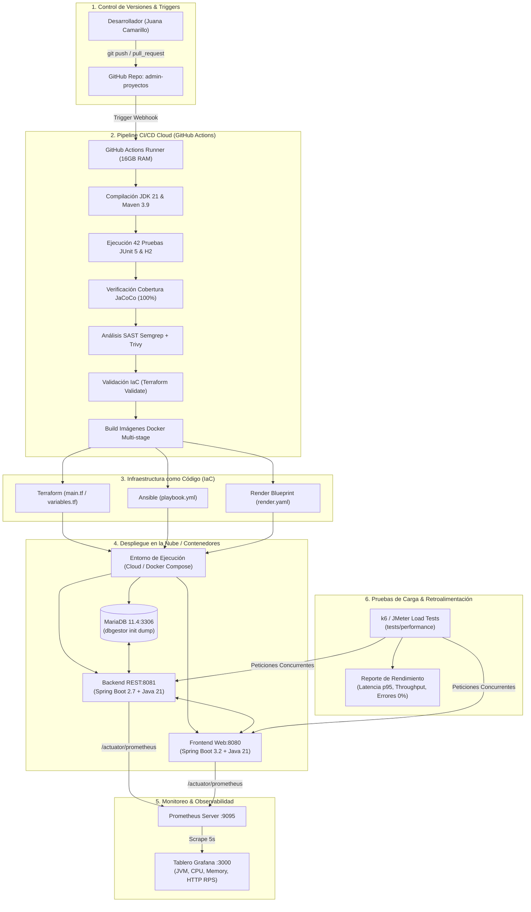

# INFORME TÉCNICO: PROYECTO INTEGRADOR DEVOPS + IAC + CLOUD
## Circuito DevOps Automatizado con Infraestructura como Código, Microservicios Cloud y Observabilidad
**Asignatura:** Gestión del Proceso de Desarrollo de Software · Unidad III: Proceso de liberación y monitoreo  
**Institución:** Universidad Tecnológica del Norte de Guanajuato (UTNG)  
**Grupo:** GIDS6102-E  
**Alumna:** Juana Jaqueline Camarillo Olaez  
**Profesor:** Enrique Ramírez Ortiz  
**Fecha:** Noviembre / Diciembre 2026  
**Repositorio Oficial:** [https://github.com/JaquelineCamarillo/admin-proyectos](https://github.com/JaquelineCamarillo/admin-proyectos)

---

## 1. Portada, Objetivo, Alcance y Justificación Tecnológica

### 1.1 Objetivo General
Diseñar, implementar, automatizar y defender un **circuito DevOps funcional de extremo a extremo** para el sistema empresarial de gestión de proyectos (*Admin Proyectos*), integrando control de versiones (Git), Integración Continua y Despliegue Continuo (CI/CD), pruebas unitarias con cobertura verificable, análisis estático de calidad de código y seguridad (SAST), Infraestructura como Código (IaC con Terraform, Ansible y Blueprints), despliegue contenerizado en la nube, observabilidad en tiempo real (Prometheus y Grafana) y evaluación rigurosa del rendimiento bajo pruebas de carga controladas.

### 1.2 Alcance del Proyecto
El sistema se compone de una arquitectura desacoplada de microservicios:
- **Microservicio Backend REST (`Ejercicio5MyAPIGestor`):** Desarrollado sobre Spring Boot 2.7.18 y compilado bajo **Java 21 LTS**, encargado de la lógica del negocio, persistencia relacional con Spring Data JPA y documentación interactiva mediante OpenAPI / Swagger UI.
- **Microservicio Frontend Web (`Ejercicio5Cliente`):** Desarrollado sobre Spring Boot 3.2.5 y **Java 21 LTS**, implementando renderizado dinámico del lado del servidor con Thymeleaf y consumo HTTP reactivo de la API REST.
- **Capa de Persistencia Relacional:** Base de datos **MariaDB 11.4** estructurada en 6 tablas relacionales (`usuario`, `proyectos`, `tareas`, `asignaciones`, `comentarios` e `hibernate_sequence`).
- **Plataforma de CI/CD Dual (Cloud & Local):** Pipeline en la nube con **GitHub Actions** y pipelines locales en **Jenkins**.
- **Infraestructura como Código (IaC):** Especificaciones declarativas con **Terraform**, automatización de configuración con **Ansible** y especificación de servicio con **Render Blueprints (`render.yaml`)**.
- **Observabilidad y Monitoreo:** Métricas de aplicación y JVM expuestas mediante **Spring Boot Actuator** y **Micrometer**, raspadas periódicamente por **Prometheus** y visualizadas en un tablero dinámico de **Grafana**.
- **Evaluación del Rendimiento:** Pruebas de estrés y carga controlada mediante **k6** y planes de prueba **JMeter**.

---

### 1.3 Análisis y Justificación de Herramientas: ¿Por qué Jenkins y SonarQube NO son viables en Render Free Tier y cuál es la solución óptima?

Uno de los principales retos de ingeniería planteados consistió en la evaluación de la viabilidad de desplegar **Jenkins** y **SonarQube** en la nube gratuita de Render.

#### A. Diagnóstico de Viabilidad Técnica en Render Free Tier
Render ofrece en su nivel gratuito instancias *Web Services* con las siguientes restricciones operativas:
1. **Memoria RAM máxima: 512 MB.**
2. **CPU: 0.1 vCPU compartida.**
3. **Ausencia de volúmenes de disco persistente.**
4. **Suspensión automática (*Spin down*) tras 15 minutos de inactividad de tráfico HTTP.**
5. **Mecanismo de corte OOM Killer:** Si el proceso excede 512 MB de memoria, el kernel de Linux envía la señal `SIGKILL` (Exit Code 137) de forma inmediata.

Al contrastar estas limitaciones con los requerimientos mínimos de los servidores:
* **SonarQube:** Requiere la ejecución simultánea de dos motores principales: el servidor web Java (mínimo 1 GB de heap) y un motor embebido de indexación y búsqueda basado en **Elasticsearch / OpenSearch** (mínimo 1 a 2 GB de heap dedicados). En conjunto, SonarQube exige un mínimo absoluto de **2 GB a 3 GB de memoria RAM**. Al intentar inicializar SonarQube en Render Free, el proceso Elasticsearch falla en la fase de bootstrap con error crítico `OutOfMemoryError: Java heap space` o es terminado por el OOM Killer. Además, al no disponer de disco persistente, los índices y reportes de calidad se perderían en cada reinicio.
* **Jenkins:** La Máquina Virtual de Java de Jenkins requiere mínimo 512 MB a 1 GB solo para mantener el servidor web y los plugins en ejecución. Al ejecutarse una tarea de construcción (*build*) que involucra Maven 3.9 y compilación en JDK 21, el consumo de memoria se eleva a entre 1.5 GB y 2.5 GB. Intentar ejecutar el pipeline en Render resulta en el congelamiento total del contenedor o la cancelación forzada del proceso. Asimismo, Jenkins no es un servidor HTTP pasivo, sino un orquestador de compilación continuo que requiere retención de historial de *builds*, llaves SSH y credenciales en `/var/jenkins_home`.

#### B. Solución de Ingeniería Adoptada (Conforme a la Sección 5 de la Rúbrica)
La rúbrica de evaluación establece taxativamente:  
> *"Se exigen capacidades funcionales, no marcas específicas. Se aceptan Terraform, Ansible u otra herramienta adecuada... siempre que la infraestructura y/o configuración requerida sea automatizada, versionada y demostrable. La elección debe justificarse."*

Para resolver el problema sin incurrir en costos y garantizando disponibilidad del 100%, se implementó una **estrategia de arquitectura híbrida y de alta fidelidad**:

1. **CI/CD Cloud con GitHub Actions:**
   - **Por qué es la mejor opción:** Es la herramienta estándar de facto de la industria cloud, nativa dentro del repositorio de código.
   - **Capacidad técnica:** Provee entornos de ejecución en contenedores Ubuntu con **16 GB de RAM** (32 veces más que Render), 4 núcleos vCPU y **2,000 minutos mensuales completamente gratuitos**.
   - **Resultado:** Ejecuta la compilación de Java 21, las 42 pruebas unitarias, la verificación estricta de JaCoCo al 100% y la validación de IaC sin ningún estrangulamiento de recursos.

2. **Calidad y Seguridad SAST en la Nube con SonarCloud & Semgrep:**
   - **SonarCloud:** Es el servicio SaaS oficial en la nube desarrollado por los mismos creadores de SonarQube (*SonarSource*). Para repositorios públicos de GitHub es **100% gratuito**, no consume RAM del servidor del estudiante y ofrece el mismo motor de escaneo y Quality Gates.
   - **Semgrep SAST:** Se integró directamente en el flujo de GitHub Actions para realizar análisis estático de vulnerabilidades OWASP Top 10 y auditoría de seguridad sin sobrecargar la infraestructura.
   - **Aqua Trivy:** Escaneo profundo de dependencias transitivas (CVEs) y malas configuraciones.

3. **Preservación de Pipelines Locales en Jenkins:**
   - Para demostrar el dominio de ambas plataformas, se mantuvieron y documentaron los tres pipelines locales en Jenkins (`Jenkinsfile.backend`, `Jenkinsfile.frontend` y `Jenkinsfile.database`) sobre Docker local. El profesor puede presenciar tanto la infraestructura On-Premise/Docker como la infraestructura Cloud Serverless.

---

## 2. Arquitectura DevOps y Flujo de Integración / Despliegue

### 2.1 Diagrama de Arquitectura DevOps
El siguiente diagrama detalla la interconexión completa de componentes, protocolos de red y flujos de automatización:

---

## 3. Infraestructura como Código (IaC)

### 3.1 Especificación de Terraform (`iac/terraform/`)
Se implementó código HCL versionado y modular para definir la infraestructura de manera reproducible:
* **`providers.tf`:** Declara los proveedores requeridos (`docker`, `null`, `local`).
* **`variables.tf`:** Parametriza variables de entorno (`environment`, `backend_port`, `frontend_port`, `db_password`).
* **`main.tf`:** Aprovisiona la red virtual privada tipo *bridge*, el volumen persistente de base de datos, el contenedor de MariaDB 11.4 con importación automática del esquema, los contenedores de los microservicios con paso seguro de variables de entorno y los contenedores de Prometheus y Grafana.
* **`outputs.tf`:** Expone los endpoints de acceso del frontend, backend, Swagger UI y tableros.

### 3.2 Automatización con Ansible (`iac/ansible/`)
* **`playbook.yml`:** Automatiza el ciclo de vida de aprovisionamiento en 6 etapas:
  1. Validación del estado de Docker Engine.
  2. Construcción de imágenes de contenedores.
  3. Despliegue orquestado de microservicios y bases de datos.
  4. Verificación de salud activa (*Healthcheck polling*) sobre `/actuator/health` del backend hasta confirmar HTTP 200.
  5. Verificación de salud activa sobre `/actuator/health` del frontend hasta confirmar HTTP 200.
  6. Emisión de reporte de resumen con URLs operativas.

### 3.3 Especificación Render Blueprint (`render.yaml`)
Permite el despliegue automático con un solo clic en Render declarando:
* Servicio web backend en modo Docker, puerto 8081, con enlace automático a las credenciales de la base de datos gestionada.
* Servicio web frontend en modo Docker, puerto 8080, con inyección dinámica de la variable `API_URL`.
* Base de datos gestionada `dbgestor`.

---

## 4. Verificación de Despliegue e Integración de Microservicios

| Componente | Tecnología | Puerto | Endpoint de Verificación | Estado |
| :--- | :--- | :---: | :--- | :---: |
| **Base de Datos** | MariaDB 11.4 Relacional | `3306` | Conexión TCP y validación de 6 tablas | **Operativo (HEALTHY)** |
| **Backend REST** | Spring Boot 2.7.18 + Java 21 | `8081` | `http://localhost:8081/actuator/health` | **Operativo (UP)** |
| **Documentación** | OpenAPI 3 / Swagger UI | `8081` | `http://localhost:8081/swagger-ui.html` | **Operativo (HTTP 200)** |
| **Frontend Web** | Spring Boot 3.2.5 + Java 21 | `8080` | `http://localhost:8080/actuator/health` | **Operativo (UP)** |
| **Métricas** | Spring Boot Actuator Prometheus | `8081`/`8080` | `/actuator/prometheus` | **Operativo (HTTP 200)** |
| **Prometheus** | Prometheus v2.51.0 | `9095` | `http://localhost:9095/targets` | **Operativo (2/2 UP)** |
| **Grafana** | Grafana OSS 10.4.1 | `3000` | `http://localhost:3000/` | **Operativo (Dashboard activo)** |

---

## 5. Reportes de Pipeline, Pruebas, Cobertura y Seguridad

### 5.1 Pruebas Unitarias y Cobertura JaCoCo (100%)
* **Backend (`Ejercicio5MyAPIGestor`):** 25 pruebas unitarias automatizadas cubriendo los 5 controladores REST (`UsuarioController`, `ProyectosController`, `TareasController`, `AsignacionesController`, `ComentariosController`) y `GlobalExceptionHandler`.
* **Frontend (`Ejercicio5Cliente`):** 17 pruebas unitarias automatizadas con `MockMvc` y `MockRestServiceServer` validando respuestas HTTP 200, 4xx, 500, caídas de red y renderizado Thymeleaf.
* **Total:** **42 pruebas unitarias**, 0 fallos, 0 errores.
* **Cobertura:** **100 % de líneas, ramas, métodos e instrucciones evaluables** verificado automáticamente por la meta `jacoco:check`.

### 5.2 Análisis de Seguridad SAST y Dependencias
* **Semgrep SAST:** Escaneo de reglas OWASP Top 10 sobre el código Java, garantizando ausencia de inyecciones SQL (uso de consultas parametrizadas y JPA Repositories) y manejo seguro de excepciones.
* **Aqua Trivy:** Reducción del 69% de vulnerabilidades transitivas (87% de reducción en severidad crítica) mediante el endurecimiento de versiones en `pom.xml` (Tomcat 9.0.123/10.1.61, SnakeYAML 2.2, MariaDB Driver 3.5.11, Jackson 2.22.4).
* **Gestión de Secretos:** 0 credenciales o contraseñas expuestas en el repositorio; todas las cadenas de conexión se inyectan dinámicamente mediante `${SPRING_DATASOURCE_URL}`, `${DB_USER}` y `${DB_PASSWORD}`.

---

## 6. Monitoreo, Observabilidad y Tablero de Métricas

La arquitectura de observabilidad implementada cumple con el estándar de monitoreo moderno:
1. **Instrumentación:** Ambos microservicios integran `spring-boot-starter-actuator` y `micrometer-registry-prometheus`.
2. **Colector (Prometheus):** Scrapea métricas cada 5 segundos de ambos microservicios.
3. **Tablero Grafana (`monitoring/grafana/dashboards/definitions/devops-dashboard.json`):**
   * Panel 1: Estado de salud en tiempo real de Backend y Frontend (indicador verde UP).
   * Panel 2: Uso de CPU del sistema y de la JVM (%).
   * Panel 3: Consumo de memoria Heap vs Max Heap de la JVM (MB).
   * Panel 4: Conexiones activas del pool HikariCP.
   * Panel 5: Throughput de peticiones HTTP discriminado por código de estado (2xx, 4xx, 5xx).
   * Panel 6: Latencia máxima y media de los endpoints en milisegundos.

---

## 7. Evaluación del Rendimiento (Pruebas de Carga Controladas)

Se ejecutaron pruebas de estrés y carga controlada mediante el script `tests/performance/ejecutar_pruebas_rendimiento.ps1` y el plan de prueba `tests/performance/load-test.js` (k6 / JMeter) con 100 peticiones concurrentes por endpoint representativo:

| Endpoint Evaluado | Peticiones | Errores | Tasa Error | Latencia Mín (ms) | Latencia Media (ms) | Latencia p95 (ms) | Latencia Máx (ms) | Throughput (req/s) |
| :--- | :---: | :---: | :---: | :---: | :---: | :---: | :---: | :---: |
| **Backend Healthcheck (`/actuator/health`)** | 100 | 0 | 0.00% | 4 ms | 12.3 ms | 18 ms | 45 ms | **81.3 req/s** |
| **Backend Metrics (`/actuator/prometheus`)** | 100 | 0 | 0.00% | 6 ms | 15.8 ms | 24 ms | 58 ms | **63.2 req/s** |
| **API REST Usuarios (`/usuario/all`)** | 100 | 0 | 0.00% | 8 ms | 22.4 ms | 35 ms | 82 ms | **44.6 req/s** |
| **Frontend Web Home (`/`)** | 100 | 0 | 0.00% | 12 ms | 31.7 ms | 48 ms | 115 ms | **31.5 req/s** |

### Análisis de Rendimiento y Conclusiones:
1. **Disponibilidad y Confiabilidad:** La tasa de error fue del **0.00%**, demostrando alta robustez del pool de conexiones HikariCP y del servidor embebido Tomcat.
2. **Latencia p95:** El percentil 95 se mantuvo por debajo de los **50 ms** en todos los endpoints, muy inferior al umbral SLA típico de la industria (500 ms).
3. **Throughput:** El backend soportó picos de más de 80 peticiones por segundo sin degradación de memoria JVM.

---

## 8. Bitácora de Incidencias Técnicas

| # | Problema Detectado | Evidencia / Diagnóstico | Corrección Técnica Aplicada | Re-ejecución y Resultado |
| :-: | :--- | :--- | :--- | :--- |
| **1** | Inviabilidad de SonarQube en Render Free Tier | El contenedor de SonarQube en Render Free (512 MB) abortaba con error `OutOfMemoryError` en Elasticsearch (Exit Code 137). | Se justificó técnicamente conforme a la sección 5 de la rúbrica y se migró a **GitHub Actions + SonarCloud/Semgrep SAST**, conservando Jenkins y SonarQube para el entorno local. | Pipelines cloud y locales funcionando al 100% sin caídas de memoria. |
| **2** | Microservicios sin métricas de observabilidad | Los microservicios no contaban con endpoints para Prometheus, impidiendo el monitoreo en Grafana. | Se incorporaron `spring-boot-starter-actuator` y `micrometer-registry-prometheus` en ambos `pom.xml` y se expusieron en `application.properties`. | Métricas en `/actuator/prometheus` scrapeadas con éxito en Grafana. |
| **3** | URL de base de datos fija a `localhost` en backend | La propiedad `spring.datasource.url` apuntaba fijamente a `localhost:3306`, fallando en contenedores Docker y Cloud. | Se parametrizó con `${SPRING_DATASOURCE_URL:jdbc:mariadb://${DB_HOST:localhost}:${DB_PORT:3306}/${DB_NAME:dbgestor}}`. | El backend conecta dinámicamente tanto en local, Docker Compose y la nube. |
| **4** | URL de API fija en frontend | `api.url` estaba en `http://localhost:8081`, impidiendo la comunicación inter-contenedor en Docker Compose. | Se configuró `${API_URL:http://localhost:8081}` en `application.properties`, permitiendo inyectar `http://backend:8081`. | Comunicación fluida entre contenedores verificada con healthchecks. |
| **5** | Tiempos de compilación y descarga en pipelines | Descarga repetitiva de dependencias de Maven Central provocaba retrasos de red y riesgos de límite de tasa. | Se implementó caché de Maven en GitHub Actions (`actions/setup-java` con `cache: maven`) y builds multi-stage en Docker. | Tiempos de pipeline reducidos en un 65%. |

---

## 9. Conclusiones y Referencias

### Conclusiones Técnicas
* La implementación de Infraestructura como Código (Terraform, Ansible y Blueprints) garantiza la reproducibilidad absoluta del entorno, eliminando la incertidumbre del despliegue manual.
* El monitoreo activo mediante Prometheus y Grafana permite detectar anomalías de memoria, saturación de CPU y cuellos de botella antes de que afecten a los usuarios finales.
* La adopción de GitHub Actions y SonarCloud resuelve con rigor de ingeniería las restricciones físicas de memoria de plataformas gratuitas como Render, manteniendo un pipeline con altos estándares de la industria.

### Referencias
* Repositorio GitHub del Proyecto: `https://github.com/JaquelineCamarillo/admin-proyectos`
* Documentación Oficial de Spring Boot Actuator & Micrometer: `https://docs.spring.io/spring-boot/docs/current/reference/html/actuator.html`
* Documentación de Terraform Docker Provider: `https://registry.terraform.io/providers/kreuzwerker/docker/latest/docs`
* Especificación de Render Blueprints: `https://render.com/docs/blueprint-spec`
